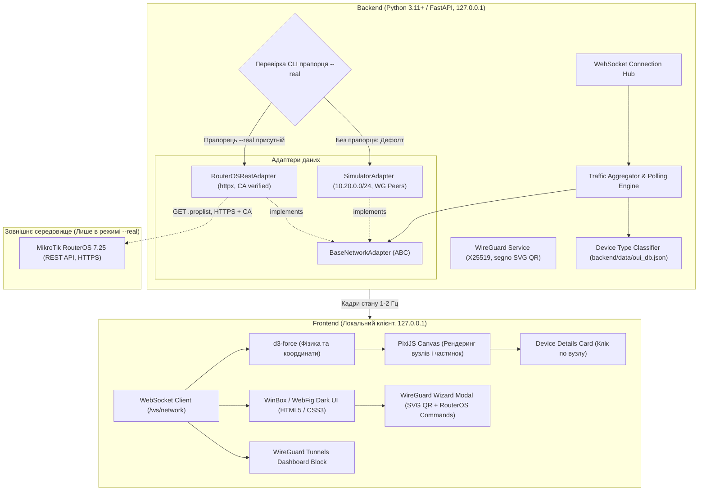

# Архітектура NetRadar

NetRadar — локальна система моніторингу та візуалізації домашньої мережі на базі MikroTik RouterOS 7.25 з підтримкою автономного симулятора.

## 1. Загальна концепція та безпека

### 1.1 Режими роботи
- **Режим симулятора (за замовчуванням)**: Застосунок стартує без прапорців або з `--simulator`. Клас `RouterOSRestAdapter` не створюється. Усі мережеві дані синтезуються в підмережі `10.20.0.0/24`.
- **Режим реального роутера (`--real`)**: Активується виключно за наявності CLI-прапорця `--real`. Без нього з'єднання з роутером неможливе архітектурно.

### 1.2 Безпека з'єднання та конфігурація
- Застосунок слухає лише локальний інтерфейс `127.0.0.1`.
- Доступ до роутера виконується через HTTPS з обов'язковою перевіркою сертифіката роутера за шляхом до CA-файлу (`ca_path`). Використання `verify=False` заборонено.
- Конфігураційний файл зберігається за межами папки проєкту. Шлях до нього передається через змінну середовища `NETRADAR_CONFIG`.
- Приватні ключі WireGuard клієнта ніколи не записуються на диск або в системні логи, а генеруються виключно в оперативній пам'яті для одного показу.

---

## 2. Схема взаємодії компонентів



---

## 3. Специфікація адаптерів даних

Обидва адаптери забезпечують постачання уніфікованого набору даних через контракт `BaseNetworkAdapter`:

### 3.1 Точки збору даних RouterOSRestAdapter (лише GET)
1. `/system/resource`:
   - `.proplist=cpu-load,free-memory,total-memory,uptime,board-name,version`
2. `/system/health`:
   - `.proplist=name,value,type` (температура плати/процесора).
3. `/interface`:
   - `.proplist=name,rx-byte,tx-byte,running` (моніторинг лише зазначеного WAN-інтерфейсу, розрахунок дельти байт).
4. `/ip/dhcp-server/lease`:
   - `.proplist=address,mac-address,host-name,comment,status,active-address`
5. `/ip/firewall/connection`:
   - `.proplist=src-address,dst-address,protocol,dst-port,orig-bytes,repl-bytes`
   - Адаптивний інтервал опитування: 2 секунди за замовчуванням; при перевищенні 5000 записів інтервал тимчасово зростає до 5 секунд для запобігання перевантаженню процесора роутера.
6. Wi-Fi реєстрації (підтримка обох пакетів):
   - Пакет WiFi: `/interface/wifi/registration-table?.proplist=interface,mac-address,signal,tx-rate,rx-rate` (поле `signal`).
   - Пакет Wireless: `/interface/wireless/registration-table?.proplist=interface,mac-address,signal-strength,tx-rate,rx-rate` (поле `signal-strength`).
   - Значення нормалізуються в показник рівня сигналу в dBm.
7. `/ip/dns/cache`:
   - `.proplist=name,address,data` (кеш співставлення IP-адрес із доменними іменами для відображення топ-напрямків).
8. `/interface/wireguard/peers`:
   - `.proplist=interface,public-key,endpoint-address,last-handshake,rx,tx,comment` (стан та активність тунелів).

### 3.2 Реалізація SimulatorAdapter
- Генерація пулу з 10-15 вузлів у межах підмережі `10.20.0.0/24`.
- Прив'язка кожного вузла до правдоподібних параметрів: виробник, тип, ім'я хоста, рівень сигналу Wi-Fi (-42...-82 dBm).
- Імітація обміну трафіком із зовнішніми доменами з віртуального DNS-кешу (video.cdn, cloud.storage, messenger.api тощо).
- Імітація наявності WireGuard-пірів з періодичними оновленнями часу рукостискання.

---

## 4. Класифікація пристроїв

Визначення категорії пристрою відбувається послідовно без мережевого сканування:
1. **DHCP Comment**: аналіз ключових слів (phone, laptop, pc, tv, printer, server, iot).
2. **DHCP Host-name**: евристики (iPhone, Galaxy, Android, DESKTOP-, MacBook тощо).
3. **Randomized MAC Bit**: перевірка локального біта першого октету:
   `(int(mac.split(':')[0], 16) & 0x02) != 0` -> автоматично класифікується як мобільний пристрій.
4. **Локальна база OUI (`backend/data/oui_db.json`)**: пошук префікса 3 байт виробника.
5. **Фолбек**: `generic`.

---

## 5. Графічний інтерфейс та візуалізація

### 5.1 Граф мережі (PixiJS + d3-force)
- Автономний розрахунок координат через `d3-force` (Spring-Mass).
- Апаратно-прискорений рендеринг у PixiJS:
  - Центральний вузол: роутер.
  - Навколишні вузли: клієнти з плавним дрейфом.
  - Потоки частинок по лініях: колір залежить від протоколу (TCP — блакитний, UDP — бурштиновий, інші — смарагдовий); щільність та швидкість визначаються обсягом переданих байт.
  - Плавна зміна прозорості (fade-in при появі, fade-out при відключенні).

### 5.2 Картка деталей пристрою
Відкривається при натисканні на будь-який вузол графа:
- IP, MAC, визначений тип та виробник.
- Рівень сигналу Wi-Fi (dBm, відсоток якості).
- Поточна швидкість та сумарний трафік.
- Топ-напрямки з'єднань (домени з DNS-кешу або зовнішні IP).

### 5.3 Дашборд та блок WireGuard
- Ліва панель у темній естетиці WinBox/WebFig (`#181a1f`, `#22252b`).
- Системні показники: CPU, RAM, температура, аптайм, графік WAN.
- Блок стану WireGuard-тунелів: список клієнтів, час останнього рукостискання, обсяги переданого трафіку.
- Журнал мережевих подій.

### 5.4 Майстер WireGuard
- **Режим "Новий інтерфейс" (двоетапний процес)**:
  - *Крок 1*: введення назви інтерфейсу, порту, підмережі тунелю, IP клієнта, endpoint та локальних мереж для `AllowedIPs`. Бекенд генерує ключі клієнта X25519 та команди для RouterOS 7.25:
    ```routeros
    /interface/wireguard add name="wireguard1" listen-port=13231 comment="netradar"
    /ip/address add address=10.10.0.1/24 interface="wireguard1" comment="netradar"
    /interface/list/member add list=LAN interface="wireguard1" comment="netradar"
    /ip/firewall/filter add chain=input action=accept protocol=udp dst-port=13231 place-before=0 comment="netradar"
    /interface/wireguard/peers add interface="wireguard1" public-key="<CLIENT_PUBLIC_KEY>" allowed-address=10.10.0.2/32 comment="netradar"
    ```
  - *Крок 2*: користувач виконує команди на роутері, копіює публічний ключ інтерфейсу роутера з `/interface/wireguard print` у поле майстра, після чого отримує конфігурацію `.conf` та векторний SVG QR-код.
- **Режим "Додати peer до наявного інтерфейсу"**:
  - Користувач одразу вказує публічний ключ сервера (або він обирається з наявних інтерфейсів роутера).
  - Генерується команда додавання peer, готовий конфіг `.conf` та SVG QR-код.
- **Генерація QR-коду**:
  - Виконується на бекенді бібліотекою `segno` у векторному форматі SVG без використання зовнішніх CDN чи клієнтських скриптів.
- **Безпека**:
  - Команди не застосовуються автоматично і призначені лише для копіювання користувачем.
  - Приватний ключ клієнта не зберігається у файли чи логи.
